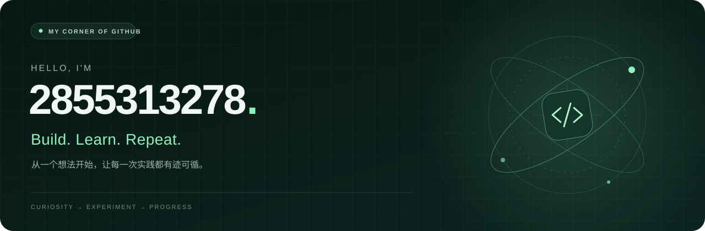

  

  <a href="https://github.com/2855313278?tab=repositories"><b>项目</b></a>
  &nbsp;&nbsp; / &nbsp;&nbsp;
  <a href="https://github.com/2855313278?tab=stars"><b>收藏</b></a>
  &nbsp;&nbsp; / &nbsp;&nbsp;
  <a href="https://github.com/2855313278?tab=overview#year-list-container"><b>动态</b></a>

 

### 👋 你好，欢迎来到我的 GitHub

这里是想法落地的起点，也是学习与实践的记录本。 
**保持好奇，动手尝试，把点滴积累变成看得见的进步。**

 

### 🧭 Learn → Build → Share

<table>
  <tr>
    <td width="33%" valign="top">
      <h3>01 / 探索</h3>
      
<b>Stay curious.</b>

      
从一个问题出发，理解原理，发现值得尝试的新方向。

    </td>
    <td width="33%" valign="top">
      <h3>02 / 实践</h3>
      
<b>Make it happen.</b>

      
让想法变成代码，从小处开始，在一次次迭代中打磨。

    </td>
    <td width="33%" valign="top">
      <h3>03 / 沉淀</h3>
      
<b>Leave a trail.</b>

      
记录思路、过程与收获，让每一步积累都有迹可循。

    </td>
  </tr>
</table>

 

### 🔎 从这里开始

- **[浏览项目](https://github.com/2855313278?tab=repositories)** · 代码与实践的入口。
- **[看看收藏](https://github.com/2855313278?tab=stars)** · 值得学习和探索的开源项目。

 

---

  Small steps. Real progress. &nbsp; / &nbsp; 每一小步，都算数。

